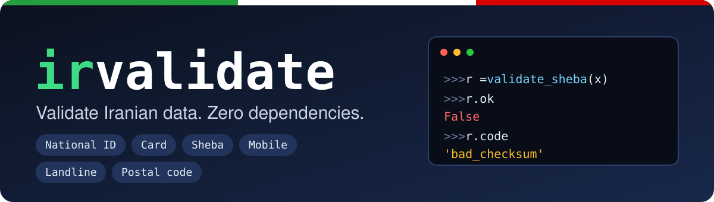

<p align="center">
  
</p>

<p align="center">
  <a href="https://github.com/mehdirzfx/irvalidate#readme">English</a> &nbsp;·&nbsp; <b>فارسی</b>
</p>

<p align="center">
  <a href="https://github.com/mehdirzfx/irvalidate/actions"></a>
  <a href="https://pypi.org/project/irvalidate/"></a>
  <a href="https://pypi.org/project/irvalidate/"></a>
  <a href="https://pypi.org/project/irvalidate/"></a>
  
  
  <a href="https://github.com/mehdirzfx/irvalidate/blob/main/LICENSE"></a>
</p>

<p align="center" dir="rtl">
  <b>اعتبارسنجی کد ملی، شماره کارت، شبا، موبایل، تلفن ثابت و کد پستی؛<br>
  در یک پکیج کوچک، تایپ‌شده و بدون هیچ وابستگی.</b>
</p>

---

## ⚡ دمو در ۳۰ ثانیه

```python
from irvalidate import (
    validate_national_id, is_valid_sheba, card_bank, mobile_operator, landline_area,
)

validate_national_id("۰۰۱۳۵۴۲۴۱۹").value             # '0013542419'
validate_national_id("1234567890").code              # 'bad_checksum'
validate_national_id("1234567890").message           # 'کد ملی نامعتبر است (رقم کنترلی اشتباه است)'
is_valid_sheba("IR58 0540 1051 8002 1273 1130 07")  # True
card_bank("6037-9910-0000-0004").name_fa             # 'بانک ملی ایران'
mobile_operator("+98 935 123 4567")                  # 'Irancell'
landline_area("021-22345678").province_fa            # 'تهران'
```

ارقام فارسی، فاصله، خط تیره و پیش‌شماره‌ی `+98` بدون هیچ کار اضافه‌ای پشتیبانی می‌شن.
و وقتی ورودی نامعتبره، **دلیلش** رو هم می‌گیری، نه فقط `False`.

```console
$ pip install irvalidate

$ irvalidate card 6037991000000004
valid
bank: بانک ملی ایران (Bank Melli Iran)

$ irvalidate national-id 1234567890
invalid
reason: bad_checksum (national ID is invalid (checksum mismatch))
```

## ✨ چرا irvalidate؟

| | کد کپی‌شده از اینترنت | **irvalidate** |
|---|:---:|:---:|
| ارقام فارسی و عربی (۰-۹) | معمولاً ✗ | ✅ |
| فاصله، خط تیره، `+98` و `0098` در ورودی | باید خودت بنویسی | ✅ |
| رقم کنترلی واقعی (کد ملی، Luhn، mod-97) | اغلب فقط یه regex | ✅ |
| رد کردن `1111111111` و امثالش | راحت فراموش می‌شه | ✅ |
| می‌گه **چرا** نامعتبره (کد خطا + پیام فارسی/انگلیسی) | ✗ | ✅ |
| تشخیص بانک، اپراتور موبایل و استان | ✗ | ✅ |
| Pydantic / FastAPI، Django، WTForms | باید خودت بنویسی | ✅ |
| تولید داده‌ی تستیِ معتبر | ✗ | ✅ |
| وابستگی در زمان اجرا | — | **۰** |
| آفلاین کار می‌کنه (هیچ داده‌ای از سیستم خارج نمی‌شه) | — | ✅ |

## 🔍 چی رو اعتبارسنجی می‌کنه؟

| داده | چی بررسی می‌شه | امکانات اضافه |
|---|---|---|
| **کد ملی** | ۱۰ رقم، رقم کنترلی، یکسان نبودن همه‌ی ارقام | |
| **شناسه ملی شرکت** | ۱۱ رقم، رقم کنترلی | |
| **شماره کارت** | ۱۶ رقم، الگوریتم Luhn | تشخیص بانک از روی ۴۴ پیش‌شماره (BIN) |
| **شبا** | `IR` + ۲۴ رقم، mod-97 (پیشوند `IR` اختیاریه) | تشخیص بانک از روی ۳۶ کد بانک |
| **موبایل** | `09…`، `9…`، `98…`، `+98…`، `0098…` | نرمال‌سازی و اپراتور (MCI، Irancell، Rightel، Taliya، Shatel Mobile، Aptel) |
| **تلفن ثابت** | پیش‌شماره + شماره‌ی ۸ رقمی | تشخیص استان از روی هر ۳۱ پیش‌شماره |
| **کد پستی** | قواعد قالب ۱۰ رقمی | |

## 📦 نصب

```bash
pip install irvalidate

# یکپارچگی با فریم‌ورک‌ها (اختیاری)
pip install "irvalidate[pydantic]"   # Pydantic v2 / FastAPI
pip install "irvalidate[django]"
pip install "irvalidate[wtforms]"
```

یا مستقیم از گیت‌هاب: `pip install git+https://github.com/mehdirzfx/irvalidate.git`

نیازمند پایتون ۳.۹ به بالا. هسته هیچ وابستگی‌ای نداره.

## 🚀 شروع سریع

برای هر نوع داده یه `is_valid_*` (خروجی `bool`) و یه `validate_*` (خروجی همراه با دلیل) وجود داره.

```python
from irvalidate import (
    is_valid_national_id, is_valid_legal_id, is_valid_card_number,
    is_valid_sheba, is_valid_mobile, is_valid_landline, is_valid_postal_code,
    normalize_mobile, normalize_landline,
)

is_valid_national_id("0013542419")           # True
is_valid_national_id("1234567890")           # False
is_valid_legal_id("14003778990")             # True
is_valid_card_number("6037-9910-0000-0004")  # True
is_valid_sheba("IR580540105180021273113007") # True
is_valid_mobile("+98 912 345 6789")          # True
is_valid_landline("021-22345678")            # True
is_valid_postal_code("1593764856")           # True

normalize_mobile("۰۹۱۲۳۴۵۶۷۸۹")               # '09123456789'
normalize_mobile("09123456789", international=True)  # '+989123456789'
normalize_landline("+982122345678")          # '02122345678'
```

## 🧭 بفهم چرا نامعتبره

```python
from irvalidate import validate_national_id, set_default_language

r = validate_national_id("1234567890")
bool(r)           # False
r.code            # 'bad_checksum'
r.message         # 'کد ملی نامعتبر است (رقم کنترلی اشتباه است)'
r.message_en      # 'national ID is invalid (checksum mismatch)'

ok = validate_national_id("۰۰۱۳۵۴۲۴۱۹")
ok.value          # '0013542419'
ok.raise_for_error()   # مقدار نرمال‌شده رو برمی‌گردونه، یا ValidationError (زیرکلاس ValueError) پرتاب می‌کنه

set_default_language("en")
r.message         # 'national ID is invalid (checksum mismatch)'
```

`r.message` از زبان پیش‌فرض پیروی می‌کنه (به‌صورت پیش‌فرض فارسی). `message_fa` و `message_en` همیشه در دسترسن.

| `code` | معنی |
|---|---|
| `not_a_string` | ورودی `str` نیست (مثلاً `int`؛ صفرهای ابتدایی ازبین می‌رن) |
| `empty` | بعد از حذف فاصله و خط تیره چیزی نمونده |
| `invalid_characters` | چیزی جز رقم وارد شده |
| `invalid_length` | تعداد ارقام اشتباهه |
| `all_same_digits` | مثل `1111111111` |
| `bad_checksum` | رقم کنترلی / Luhn / mod-97 نمی‌خونه |
| `invalid_format` | ساختار نادرسته (موبایل، تلفن ثابت، کد پستی) |
| `unknown_area_code` | پیش‌شماره‌ی تلفن ثابت وجود نداره |

## 🔌 یکپارچگی با فریم‌ورک‌ها

### Pydantic / FastAPI

```python
from fastapi import FastAPI
from pydantic import BaseModel
from irvalidate.integrations.pydantic import NationalId, MobileNumber

class User(BaseModel):
    national_id: NationalId   # "۰۰۱۳۵۴۲۴۱۹"       -> "0013542419"
    mobile: MobileNumber      # "+98 912 345 6789" -> "09123456789"

app = FastAPI()

@app.post("/users")
def create(user: User):
    return user
```

ورودی نامعتبر یه خطای `422` با پیام فارسی (یا انگلیسی) برمی‌گردونه، و مقداری که تحویل می‌گیری از قبل نرمال شده.
انواع موجود: `NationalId`، `LegalId`، `CardNumber`، `Sheba`، `MobileNumber`، `PostalCode`، `Landline`.

### Django

```python
from django.db import models
from irvalidate.integrations.django import national_id_validator, mobile_validator

class Profile(models.Model):
    national_id = models.CharField(max_length=10, validators=[national_id_validator])
    mobile = models.CharField(max_length=14, validators=[mobile_validator])
```

کد خطا در `ValidationError.code` قرار می‌گیره. ولیدیتورها تابع‌های ساده‌ی سطح ماژول‌اند، پس در migrationها بدون مشکل serialize می‌شن.
موجود: `national_id_validator`، `legal_id_validator`، `card_number_validator`، `sheba_validator`، `mobile_validator`، `postal_code_validator`، `landline_validator`.

### WTForms

```python
from wtforms import Form, StringField
from irvalidate.integrations.wtforms import NationalId, MobileNumber

class SignupForm(Form):
    national_id = StringField(validators=[NationalId()])
    mobile = StringField(validators=[MobileNumber(message="موبایل درست نیست")])
```

## 🧪 تولید داده‌ی تستی

برای تست و fixture داده‌ی فیکِ معتبر لازم داری؟

```python
import random
from irvalidate import (
    generate_national_id, generate_legal_id, generate_card_number, generate_sheba,
    generate_mobile, generate_landline, generate_postal_code, is_valid_sheba,
)

generate_national_id()                 # مثلاً 1043321810
generate_card_number(bank="Mellat")    # کارت معتبر با BIN بانک ملت
generate_sheba(bank="Parsian")         # شبای معتبر بانک پارسیان
generate_mobile("Irancell")            # مثلاً 09359141777
generate_landline("021")               # یه تلفن ثابت تهران

rng = random.Random(42)                # خروجی تکرارپذیر
is_valid_sheba(generate_sheba(rng=rng))  # True
```

> مقدارهای تولیدشده فقط از نظر **ساختار و رقم کنترلی** معتبرن و برای تست و داده‌ی فیکن. ممکنه تصادفاً با شماره‌ی واقعی یه نفر یکی باشن؛ پس هرگز برای جعل هویت ازشون استفاده نکن. منبع تصادفی پیش‌فرض هم برای امنیت مناسب نیست.

## 🎨 فرمت، ماسک و نرمال‌سازی

```python
from irvalidate import (
    mask_card_number, format_card_number, format_sheba,
    format_mobile, format_landline, to_persian_digits,
)

mask_card_number("6037991000000004")        # '6037-99**-****-0004'
format_card_number("6037991000000004")      # '6037-9910-0000-0004'
format_sheba("IR580540105180021273113007")  # 'IR58 0540 1051 8002 1273 1130 07'
format_mobile("+989123456789")              # '0912 345 6789'
format_landline("02122345678")              # '021-22345678'
to_persian_digits("0912")                   # '۰۹۱۲'
```

## 💻 خط فرمان

```bash
irvalidate national-id 0013542419
irvalidate sheba IR580540105180021273113007
irvalidate mobile +989351234567     # valid + operator: Irancell
irvalidate landline 02122345678     # valid + province: تهران (Tehran)
irvalidate card --generate          # یه شماره کارت تستیِ معتبر چاپ می‌کنه
# انواع: national-id, legal-id, card, sheba, mobile, landline, postal-code
```

کد خروج برای معتبر `0` و برای نامعتبر `1` است؛ پس در اسکریپت‌های شل هم کار می‌کنه.

## 📚 فهرست سریع توابع

| دسته | توابع |
|---|---|
| اعتبارسنجی (`bool`) | `is_valid_national_id` · `is_valid_legal_id` · `is_valid_card_number` · `is_valid_sheba` · `is_valid_mobile` · `is_valid_landline` · `is_valid_postal_code` |
| اعتبارسنجی (با دلیل) | `validate_national_id` · `validate_legal_id` · `validate_card_number` · `validate_sheba` · `validate_mobile` · `validate_landline` · `validate_postal_code` ← `ValidationResult` |
| جستجو | `card_bank` · `sheba_bank` · `mobile_operator` · `landline_area` |
| نرمال‌سازی | `normalize_card_number` · `normalize_sheba` · `normalize_mobile` · `normalize_landline` |
| فرمت / ماسک | `format_card_number` · `mask_card_number` · `format_sheba` · `format_mobile` · `format_landline` |
| ارقام | `to_english_digits` · `to_persian_digits` |
| تولید داده | `generate_national_id` · `generate_legal_id` · `generate_card_number` · `generate_sheba` · `generate_mobile` · `generate_landline` · `generate_postal_code` |
| تنظیمات / خطا | `set_default_language` · `get_default_language` · `ValidationResult` · `ValidationError` |

همه‌چیز کامل type-annotate شده (`py.typed`).

## ⚠️ نکته‌های مهم

- **معتبر بودن ≠ وجود داشتن.** فقط ساختار و رقم کنترلی بررسی می‌شه. کتابخونه نمی‌تونه بگه کارت یا کد ملی واقعاً مال کسی هست یا نه، و کد پستی هم فقط از نظر قالب چک می‌شه.
- **رشته بده، نه عدد.** کد ملی‌ای مثل `0013542419` وقتی به `int` تبدیل می‌شه صفر ابتداش رو از دست می‌ده؛ ورودی غیررشته‌ای با `not_a_string` رد می‌شه.
- فقط ارقام `0-9` و ارقام فارسی/عربی پذیرفته می‌شن؛ ارقام الفباهای دیگه رد می‌شن.
- **جدول‌های اطلاعاتی حداکثر تلاش ممکنه.** BIN بانک‌ها و کد شبا، پیش‌شماره‌ی اپراتورهای موبایل و پیش‌شماره‌ی استان‌ها از اطلاعات عمومی اومده و ممکنه ناقص یا قدیمی باشه (بانک‌های ادغام‌شده، بازه‌های جدید). اصلاحیه‌ها خیلی خوش‌آمدن.
- تلفن ثابت: پیش‌شماره + شماره‌ی ۸ رقمی. شماره‌های قدیمی ۷ رقمی و شماره‌های خدماتی (مثل ۱۱۰) پشتیبانی نمی‌شن.

## ❓ سؤال‌های رایج

**به سرور یا اینترنت وصل می‌شه؟** نه. همه‌چیز تابع‌های محضه: آفلاین کار می‌کنه و هیچ داده‌ای جایی فرستاده نمی‌شه.

**چرا `is_valid_national_id(13542419)` مقدار `False` می‌ده؟** به بخش «رشته بده، نه عدد» نگاه کن؛ تا اون موقع صفرهای ابتدایی از دست رفته.

**می‌شه تجاری ازش استفاده کرد؟** بله، مجوزش MIT است.

**زبان پیام‌ها رو چطور عوض کنم؟** با `set_default_language("en")` یا `"fa"`؛ یا مستقیم `message_en` / `message_fa` رو بخون.

## 🤝 مشارکت

مشارکتت خیلی ارزشمنده، مخصوصاً **اصلاح داده‌ها** (بانک‌ها، BINها، اپراتورها، پیش‌شماره‌ها) همراه با لینک منبع.

```bash
git clone https://github.com/mehdirzfx/irvalidate.git
cd irvalidate
pip install -e ".[dev]"
pytest
```

داده‌ی بانک‌ها و شبا در [`src/irvalidate/banks.py`](https://github.com/mehdirzfx/irvalidate/blob/main/src/irvalidate/banks.py)، اپراتورهای موبایل در `mobile.py` و پیش‌شماره‌ها در `landline.py` هستن.
تغییرات بین نسخه‌ها در [CHANGELOG](https://github.com/mehdirzfx/irvalidate/blob/main/CHANGELOG.md) هست.

اگه irvalidate وقتت رو گرفته، یه ⭐ در گیت‌هاب کمک می‌کنه بقیه هم پیداش کنن.

## 📄 مجوز

[MIT](https://github.com/mehdirzfx/irvalidate/blob/main/LICENSE). آزاد برای استفاده‌ی شخصی و تجاری.
