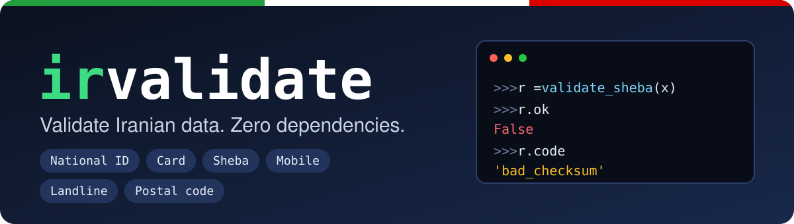

<p align="center">
  
</p>

<p align="center">
  <b>English</b> &nbsp;·&nbsp; <a href="https://github.com/mehdirzfx/irvalidate/blob/main/README.fa.md">فارسی</a>
</p>

<p align="center">
  <a href="https://github.com/mehdirzfx/irvalidate/actions"></a>
  <a href="https://pypi.org/project/irvalidate/"></a>
  <a href="https://pypi.org/project/irvalidate/"></a>
  <a href="https://pypi.org/project/irvalidate/"></a>
  
  
  <a href="https://github.com/mehdirzfx/irvalidate/blob/main/LICENSE"></a>
</p>

<p align="center">
  <b>Validate Iranian national IDs, bank cards, Sheba numbers, mobiles, landlines and postal codes,<br>
  in one tiny, typed, zero-dependency package.</b>
</p>

<p align="center" dir="rtl">
  اعتبارسنجی کد ملی، کارت، شبا، موبایل، تلفن ثابت و کد پستی؛ در یک پکیج کوچک، تایپ‌شده و بدون هیچ وابستگی
</p>

---

## ⚡ 30-second demo

```python
from irvalidate import (
    validate_national_id,
    is_valid_sheba,
    card_bank,
    mobile_operator,
    landline_area,
)

validate_national_id("۰۰۱۳۵۴۲۴۱۹").value  # '0013542419'
validate_national_id("1234567890").code  # 'bad_checksum'
validate_national_id("1234567890").message_en  # 'national ID is invalid (checksum mismatch)'
is_valid_sheba("IR58 0540 1051 8002 1273 1130 07")  # True
card_bank("6037-9910-0000-0004").name_en  # 'Bank Melli Iran'
mobile_operator("+98 935 123 4567")  # 'Irancell'
landline_area("021-22345678").province_en  # 'Tehran'
```

Persian digits, spaces, dashes and `+98` prefixes just work. And when something is
invalid, you get **the reason**, not just `False`.

```console
$ pip install irvalidate

$ irvalidate card 6037991000000004
valid
bank: بانک ملی ایران (Bank Melli Iran)

$ irvalidate national-id 1234567890
invalid
reason: bad_checksum (national ID is invalid (checksum mismatch))
```

## ✨ Why irvalidate?

| | A copy-pasted snippet | **irvalidate** |
|---|:---:|:---:|
| Persian / Arabic digits (۰-۹) | usually ✗ | ✅ |
| Spaces, dashes, `+98`, `0098` in input | do it yourself | ✅ |
| Real checksums (national ID, Luhn, mod-97) | often just a regex | ✅ |
| Rejects `1111111111` and friends | easy to forget | ✅ |
| Tells you **why** it failed (code + Persian/English message) | ✗ | ✅ |
| Bank, mobile operator, province lookup | ✗ | ✅ |
| Pydantic / FastAPI, Django, WTForms | write it yourself | ✅ |
| Valid test-data generators | ✗ | ✅ |
| Runtime dependencies | n/a | **0** |
| Works offline (no network, no data leaves your machine) | n/a | ✅ |

## 🔍 What it validates

| Data | What is verified | Extras |
|---|---|---|
| **National ID** (کد ملی) | 10 digits, checksum, not all-same digits | |
| **Legal ID** (شناسه ملی شرکت) | 11 digits, checksum | |
| **Bank card** (شماره کارت) | 16 digits, Luhn | issuing bank from 49 BIN prefixes |
| **Sheba** (شبا) | `IR` + 24 digits, ISO 7064 mod-97 (`IR` is optional) | bank from 37 bank codes |
| **Mobile** (موبایل) | `09…`, `9…`, `98…`, `+98…`, `0098…` | normalization, operator (MCI, Irancell, Rightel, Taliya, Shatel Mobile, generic MVNO) |
| **Landline** (تلفن ثابت) | area code + 8-digit number | province from all 31 area codes |
| **Postal code** (کد پستی) | 10-digit format rules | |

## 📦 Install

```bash
pip install irvalidate

# optional framework integrations
pip install "irvalidate[pydantic]"   # Pydantic v2 / FastAPI
pip install "irvalidate[django]"
pip install "irvalidate[wtforms]"
```

Or straight from GitHub: `pip install git+https://github.com/mehdirzfx/irvalidate.git`

Requires Python 3.10+. The core has no dependencies.

## 🚀 Quick start

Every kind has an `is_valid_*` (returns `bool`) and a `validate_*` (returns a result with the reason).

```python
from irvalidate import (
    is_valid_national_id,
    is_valid_legal_id,
    is_valid_card_number,
    is_valid_sheba,
    is_valid_mobile,
    is_valid_landline,
    is_valid_postal_code,
    normalize_mobile,
    normalize_landline,
    card_bank,
    merged_into,
)

is_valid_national_id("0013542419")  # True
is_valid_national_id("1234567890")  # False
is_valid_legal_id("14003778990")  # True
is_valid_card_number("6037-9910-0000-0004")  # True
is_valid_sheba("IR580540105180021273113007")  # True
is_valid_mobile("+98 912 345 6789")  # True
is_valid_landline("021-22345678")  # True
is_valid_postal_code("1593764856")  # True

card_bank("6273810000000009").name_en  # 'Ansar Bank'
merged_into(card_bank("6273810000000009")).name_en  # 'Bank Sepah'  (Ansar was merged into Sepah)

normalize_mobile("۰۹۱۲۳۴۵۶۷۸۹")  # '09123456789'
normalize_mobile("09123456789", international=True)  # '+989123456789'
normalize_landline("+982122345678")  # '02122345678'
```

## 🧭 Know *why* it failed

```python
from irvalidate import validate_national_id, set_default_language

r = validate_national_id("1234567890")
bool(r)  # False
r.code  # 'bad_checksum'
r.message  # 'کد ملی نامعتبر است (رقم کنترلی اشتباه است)'
r.message_en  # 'national ID is invalid (checksum mismatch)'

ok = validate_national_id("۰۰۱۳۵۴۲۴۱۹")
ok.value  # '0013542419'
ok.raise_for_error()  # returns the normalized value, or raises ValidationError (a ValueError)

set_default_language("en")
r.message  # 'national ID is invalid (checksum mismatch)'
```

`r.message` follows the default language (Persian out of the box); `message_fa` and `message_en` are always available.

| `code` | Meaning |
|---|---|
| `not_a_string` | the input isn't a `str` (e.g. an `int`, which would lose leading zeros) |
| `empty` | nothing left after removing spaces and dashes |
| `invalid_characters` | something other than digits |
| `invalid_length` | wrong number of digits |
| `all_same_digits` | e.g. `1111111111` |
| `bad_checksum` | checksum / Luhn / mod-97 mismatch |
| `invalid_format` | wrong shape (mobile, landline, postal code) |
| `unknown_area_code` | landline area code doesn't exist |

## 🔌 Framework integrations

### Pydantic / FastAPI

```python
from fastapi import FastAPI
from pydantic import BaseModel
from irvalidate.integrations.pydantic import NationalId, MobileNumber


class User(BaseModel):
    national_id: NationalId  # "۰۰۱۳۵۴۲۴۱۹"       -> "0013542419"
    mobile: MobileNumber  # "+98 912 345 6789" -> "09123456789"


app = FastAPI()


@app.post("/users")
def create(user: User):
    return user
```

Invalid input returns a `422` whose message is the Persian (or English) reason. The values you receive are already normalized.
Types: `NationalId`, `LegalId`, `CardNumber`, `Sheba`, `MobileNumber`, `PostalCode`, `Landline`.

### Django

```python
from django.db import models
from irvalidate.integrations.django import national_id_validator, mobile_validator


class Profile(models.Model):
    national_id = models.CharField(max_length=10, validators=[national_id_validator])
    mobile = models.CharField(max_length=14, validators=[mobile_validator])
```

The error code lands in `ValidationError.code`. Validators are plain module-level functions, so they serialize cleanly in migrations.
Available: `national_id_validator`, `legal_id_validator`, `card_number_validator`, `sheba_validator`, `mobile_validator`, `postal_code_validator`, `landline_validator`.

### WTForms

```python
from wtforms import Form, StringField
from irvalidate.integrations.wtforms import NationalId, MobileNumber


class SignupForm(Form):
    national_id = StringField(validators=[NationalId()])
    mobile = StringField(validators=[MobileNumber(message="Invalid mobile number")])
```

## 🧪 Test-data generators

Need valid-looking fake data for tests and fixtures?

```python
import random
from irvalidate import (
    generate_national_id,
    generate_legal_id,
    generate_card_number,
    generate_sheba,
    generate_mobile,
    generate_landline,
    generate_postal_code,
    is_valid_sheba,
)

generate_national_id()  # e.g. 1043321810
generate_card_number(bank="Mellat")  # a valid card with a Mellat BIN
generate_sheba(bank="Parsian")  # a valid Sheba for Parsian
generate_mobile("Irancell")  # e.g. 09359141777
generate_landline("021")  # a Tehran landline

rng = random.Random(42)  # reproducible output
is_valid_sheba(generate_sheba(rng=rng))  # True
```

> Generated values are valid in **shape and checksum only**, for tests and fake data. They may coincide with a real person's number, so never use them to impersonate anyone. The default random source is not cryptographically secure.

## 🎨 Format, mask & normalize

```python
from irvalidate import (
    mask_card_number,
    format_card_number,
    format_sheba,
    format_mobile,
    format_landline,
    to_persian_digits,
)

mask_card_number("6037991000000004")  # '6037-99**-****-0004'
format_card_number("6037991000000004")  # '6037-9910-0000-0004'
format_sheba("IR580540105180021273113007")  # 'IR58 0540 1051 8002 1273 1130 07'
format_mobile("+989123456789")  # '0912 345 6789'
format_landline("02122345678")  # '021-22345678'
to_persian_digits("0912")  # '۰۹۱۲'
```

## 💻 Command line

```bash
irvalidate national-id 0013542419
irvalidate sheba IR580540105180021273113007
irvalidate mobile +989351234567     # valid + operator: Irancell
irvalidate landline 02122345678     # valid + province: تهران (Tehran)
irvalidate card --generate          # print a valid test card number
# kinds: national-id, legal-id, card, sheba, mobile, landline, postal-code
```

Exit code is `0` for valid and `1` for invalid, so it works in shell scripts.

## 📚 API cheat sheet

| Category | Functions |
|---|---|
| Validate (`bool`) | `is_valid_national_id` · `is_valid_legal_id` · `is_valid_card_number` · `is_valid_sheba` · `is_valid_mobile` · `is_valid_landline` · `is_valid_postal_code` |
| Validate (with reason) | `validate_national_id` · `validate_legal_id` · `validate_card_number` · `validate_sheba` · `validate_mobile` · `validate_landline` · `validate_postal_code` → `ValidationResult` |
| Look up | `card_bank` · `sheba_bank` · `merged_into` · `mobile_operator` · `landline_area` |
| Normalize | `normalize_card_number` · `normalize_sheba` · `normalize_mobile` · `normalize_landline` |
| Format / mask | `format_card_number` · `mask_card_number` · `format_sheba` · `format_mobile` · `format_landline` |
| Digits | `to_english_digits` · `to_persian_digits` |
| Generate | `generate_national_id` · `generate_legal_id` · `generate_card_number` · `generate_sheba` · `generate_mobile` · `generate_landline` · `generate_postal_code` |
| Config / errors | `set_default_language` · `get_default_language` · `ValidationResult` · `ValidationError` |

Everything is fully type-annotated (`py.typed`).

## ⚠️ Good to know

- **Valid ≠ exists.** Only structure and checksums are verified. The library can't tell whether a card or national ID belongs to a real person, and a postal code is checked for format only.
- **Pass strings, not numbers.** A national ID like `0013542419` loses its leading zero as an `int`; non-string input is rejected with `not_a_string`.
- Only the digits `0-9` and Persian/Arabic-Indic digits are accepted; other scripts' digits are rejected.
- **The lookup tables are cross-checked, not official.** Bank BINs, Sheba codes, mobile prefixes and area codes were verified against several independent public sources, but I could not obtain an official Central Bank, Shetab or CRA document. Banks keep their name as of the BIN allocation (merged banks are flagged by `merged_into`). Every entry, every correction and the open questions are documented in [`DATA_SOURCES.md`](https://github.com/mehdirzfx/irvalidate/blob/main/DATA_SOURCES.md). Corrections with a source are very welcome.
- Landlines: area code + 8-digit subscriber number. Old 7-digit numbers and service numbers (like 110) are not supported.

## ❓ FAQ

**Does it call any server?** No. Everything is a pure function: offline, nothing is sent anywhere.

**Why does `is_valid_national_id(13542419)` return `False`?** See "Pass strings, not numbers" above. The leading zeros are already gone by then.

**Can I use it commercially?** Yes, it's MIT-licensed.

**How do I change the language of the messages?** `set_default_language("en")` or `"fa"`. Or read `message_en` / `message_fa` directly.

## 🤝 Contributing

Contributions are very welcome, especially **data fixes** (banks, BINs, operators, area codes) with a source link.

```bash
git clone https://github.com/mehdirzfx/irvalidate.git
cd irvalidate
pip install -e ".[dev]"
pytest
```

Bank and Sheba data live in [`src/irvalidate/banks.py`](https://github.com/mehdirzfx/irvalidate/blob/main/src/irvalidate/banks.py), mobile operators in `mobile.py` and area codes in `landline.py`. Please read [`CONTRIBUTING.md`](https://github.com/mehdirzfx/irvalidate/blob/main/CONTRIBUTING.md) and [`DATA_SOURCES.md`](https://github.com/mehdirzfx/irvalidate/blob/main/DATA_SOURCES.md) first.
See the [changelog](https://github.com/mehdirzfx/irvalidate/blob/main/CHANGELOG.md) for what changed between versions.

If irvalidate saves you time, a ⭐ on GitHub helps other people find it.

## 📄 License

[MIT](https://github.com/mehdirzfx/irvalidate/blob/main/LICENSE). Free for personal and commercial use.
